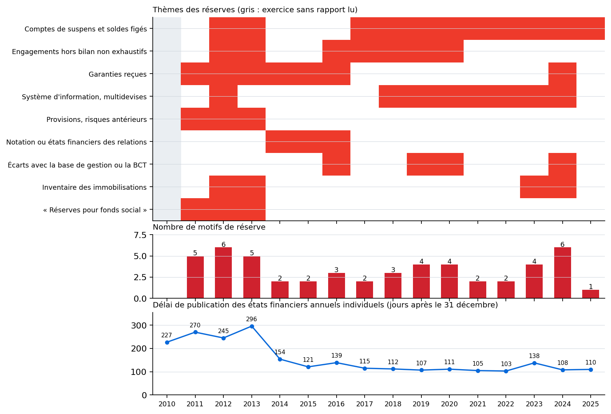

# Société tunisienne de banque (STB) : en bref

**Premier jet : toute suggestion est la bienvenue.**

Fiche produite par un script à partir des relevés du volume ; elle n'est pas dans le volume.

## Actionnaires et capital

| Détenteur | Part du capital (%) |
|---|---|
| État | 71,54 |
| CNSS | 5,69 |

Capital : 776,875 MD depuis le 2015-06-03 (18 opérations relevées depuis 1957).

## Résultat net et dividende

| Exercice | Résultat net (MD) | Dividende par action (DT) | Dividende revenant à l'État (MD) |
|---|---|---|---|
| 2023 | 59,7 | – | – |
| 2024 | 103,3 | – | – |
| 2025 | 58,7 | 0,2 | 22,2 |

## Le groupe : entités consolidées

| Exercice | 2010 | 2011 | 2012 | 2013 | 2014 | 2015 | 2016 | 2017 | 2018 | 2019 | 2020 | 2021 |
|---|---|---|---|---|---|---|---|---|---|---|---|---|
| Entités, mère non comprise | 17 | 23 | 24 | 24 | 19 | 21 | 21 | 20 | 21 | 21 | 21 | 21 |

## Opinion des commissaires aux comptes

Opinion avec réserves dans les 15 exercices lus (2011 à 2025). Le délai de publication se compte en jours après le 31 décembre.

| Exercice | 2011 | 2012 | 2013 | 2014 | 2015 | 2016 | 2017 | 2018 | 2019 | 2020 | 2021 | 2022 | 2023 | 2024 | 2025 |
|---|---|---|---|---|---|---|---|---|---|---|---|---|---|---|---|
| Motifs de réserve | 5 | 6 | 5 | 2 | 2 | 3 | 2 | 3 | 4 | 4 | 2 | 2 | 4 | 6 | 1 |
| Délai de publication (jours) | 270 | 245 | 296 | 154 | 121 | 139 | 115 | 112 | 107 | 111 | 105 | 103 | 138 | 108 | 110 |

{ width=72% }

## Limites

- Les actionnaires de moins de 5 % ne sont pas nommés par la Bourse.
- Le périmètre est celui que la banque imprime ; un exercice absent du relevé n'est pas comblé.
- Le thème d'un motif est un classement du relevé, non un jugement du rapport.
- Les sources de chaque chiffre sont dans le volume (section de la banque, partie III).
