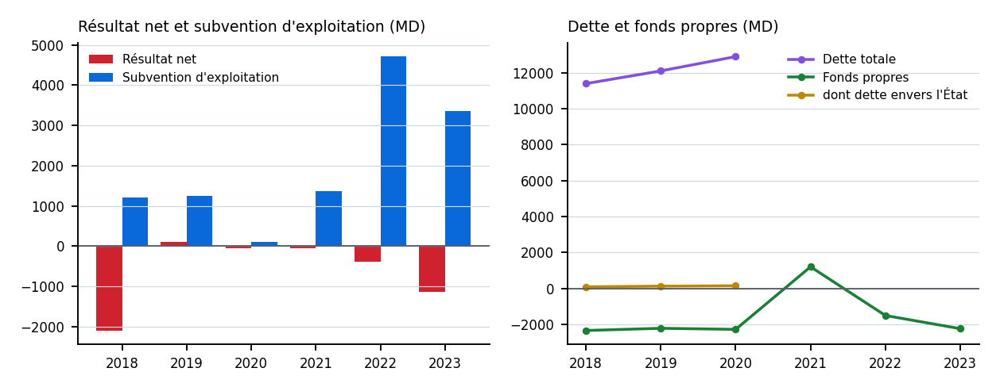

# Société tunisienne de l'électricité et du gaz (STEG) : fiche en bref

**Premier jet : toute suggestion est la bienvenue.**

*Exemple préparé après la réunion du 3 novembre 2026 ; il n'est pas dans le volume. Les chiffres viennent des fiches du rapport du ministère des Finances (dernière édition qui donne chaque exercice) ; l'identité, du Registre national des entreprises.*

## Identité

- **Forme au Registre** : établissement public, actif
- **Identifiant du Registre** : 0005910D
- **États financiers déposés au Registre** : 2024 (6 documents listés)

## Les chiffres, 2018-2023 (millions de dinars courants)

| Exercice | 2018 | 2019 | 2020 | 2021 | 2022 | 2023 |
|---|---|---|---|---|---|---|
| Produits d'exploitation | 5 810,7 | 6 793,0 | 5 663,0 | 7 008,6 | 10 826,3 | 9 577,8 |
| Résultat net | −2 093,5 | 106,4 | −60,2 | −42,7 | −381,2 | −1 139,1 |
| Subvention d'exploitation | 1 200,0 | 1 242,0 | 100,0 | 1 368,8 | 4 707,4 | 3 365,0 |
| Fonds propres | −2 341,8 | −2 219,8 | −2 279,0 | 1 201,9 | −1 507,9 | −2 240,7 |
| Dette totale | 11 397,4 | 12 104,5 | 12 900,1 | – | – | – |
| dont dette envers l'État | 88,8 | 124,4 | 145,5 | – | – | – |
| Effectif (agents) | 12 031 | 13 063 | 13 501 | 13 854 | 13 473 | 13 979 |
| Édition du ministère | LF 2022 | LF 2022 | LF 2024 | LF 2025 | LF 2025 | LF 2025 |

{ width=95% }

## Lectures

- **Subvention d'exploitation rapportée aux produits d'exploitation** : 2018 : 20,7 %, 2019 : 18,3 %, 2020 : 1,8 %, 2021 : 19,5 %, 2022 : 43,5 %, 2023 : 35,1 % (calcul du script, non imprimé dans le rapport).
- **Fonds propres** de −2 341,8 MD en 2018 à −2 240,7 MD en 2023.
- **Dette totale** de 11 397,4 MD en 2018 à 12 900,1 MD en 2020, dont 145,5 MD envers l'État en 2020.

## Limites

- Les éditions ne se raccordent pas : un exercice est lu dans la dernière édition qui le donne ; l'édition est indiquée sous chaque colonne.
- Les derniers exercices de chaque édition sont souvent provisoires ; le statut est dans les séries du volume.
- La subvention d'exploitation est une ligne comptable de l'entreprise : elle ne se confond pas avec les transferts du budget.
- **« – » pour Dette totale et dont État, exercices 2021, 2022, 2023** : la grandeur n'est imprimée que dans l'édition LF 2022. Les autres éditions impriment d'autres lignes sous un autre code (dont emprunts à plus d'un an) : elles ne se raccordent pas et ne sont pas additionnées ici.
