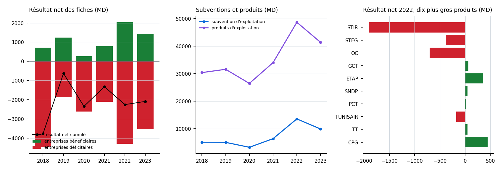
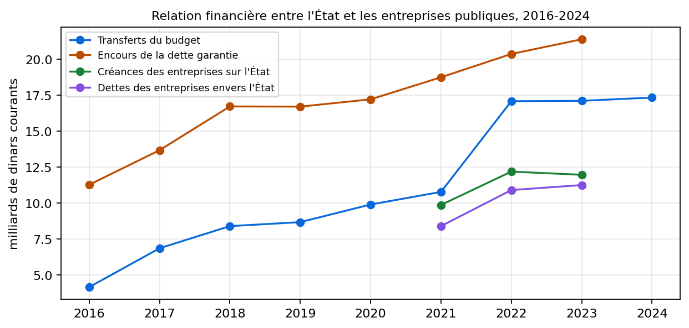

# Tableau de bord du portefeuille des entreprises publiques, 2018-2023

**Premier jet : toute suggestion est la bienvenue.**

*Exemple préparé après la réunion du 3 novembre 2026 ; il n'est pas dans le volume. Il est engendré par `scripts/exemples_reunion_soes.py` à partir des 47 fiches d'entreprises du rapport du ministère des Finances annexé aux projets de loi de finances (éditions LF 2022, LF 2024 et LF 2025 : chaque exercice est lu dans la dernière édition qui le donne). Rien n'est saisi à la main.*

## En un coup d'œil

{ width=100% }

| Exercice | 2018 | 2019 | 2020 | 2021 | 2022 | 2023 |
|---|---|---|---|---|---|---|
| Entreprises avec résultat net | 45 | 45 | 45 | 45 | 45 | 42 |
| dont en perte | 26 | 28 | 31 | 24 | 21 | 19 |
| Résultat net cumulé (MD) | −3 763 | −627 | −2 341 | −1 317 | −2 249 | −2 084 |
| Bénéfices cumulés (MD) | 708 | 1 242 | 273 | 791 | 2 035 | 1 444 |
| Pertes cumulées (MD) | −4 471 | −1 868 | −2 614 | −2 108 | −4 284 | −3 527 |
| Subvention d'exploitation (MD) | 5 067 | 5 005 | 3 212 | 6 356 | 13 548 | 9 869 |
| Entreprises avec subvention renseignée | 39 | 39 | 42 | 34 | 34 | 29 |
| Produits d'exploitation (MD) | 30 401 | 31 597 | 26 464 | 34 046 | 48 719 | 41 407 |

## Zoom : les dix plus grandes entreprises par produits d'exploitation en 2022

| Entreprise | Produits d'exploitation (MD) | Résultat net (MD) | Subvention d'exploitation (MD) | Total des passifs hors fonds propres (MD) |
|---|---|---|---|---|
| STIR | 10 977 | −1 903 | 4 101 | 4 717 |
| STEG | 10 826 | −381 | 4 707 | 16 442 |
| OC | 4 733 | −701 | 3 653 | 8 054 |
| GCT | 3 179 | 63 | – | 3 198 |
| ETAP | 3 151 | 352 | 0 | 4 505 |
| SNDP | 2 732 | 46 | 0 | 1 243 |
| PCT | 1 687 | 14 | – | 1 744 |
| TUNISAIR | 1 414 | −176 | 0 | – |
| TT | 1 410 | 49 | 0 | 1 959 |
| CPG | 1 389 | 445 | – | 1 012 |

## La relation financière avec l'État

Quatre grandeurs que le précis reprend du rapport du ministère des Finances et des lois de finances, en milliards de dinars courants.

{ width=95% }

| Grandeur | 2016 | 2017 | 2018 | 2019 | 2020 | 2021 | 2022 | 2023 | 2024 |
|---|---|---|---|---|---|---|---|---|---|
| Transferts du budget | 4,2 | 6,9 | 8,4 | 8,7 | 9,9 | 10,8 | 17,1 | 17,1 | 17,3 |
| Encours de la dette garantie | 11,3 | 13,7 | 16,7 | 16,7 | 17,2 | 18,7 | 20,4 | 21,4 | – |
| Créances des entreprises sur l'État | – | – | – | – | – | 9,9 | 12,2 | 12,0 | – |
| Dettes des entreprises envers l'État | – | – | – | – | – | 8,4 | 10,9 | 11,2 | – |
| Part de l'État dans les bénéfices (MD) | – | 163,0 | 333,0 | 263,8 | 98,3 | 145,4 | 204,6 | 195,6 | – |

Les transferts du budget font 6,717 % du PIB en 2017 et 11,419 % en 2023 ; ce total contient les caisses de sécurité sociale, la compensation et les établissements d'enseignement : il n'est pas le coût des entreprises publiques. Les créances et les dettes croisées ne sont données que depuis 2021. 2024 : loi de finances pour les transferts ; l'encours de la dette garantie n'est estimé qu'à fin juin 2024 (21,5 milliards) et n'est pas repris ici.

## Les sociétés cotées où l'État est actionnaire direct

D'après les pages de la Bourse de Tunis (actionnaires, résultat net et dividende de l'assemblée la plus récente).

| Société | Part de l'État (%) | Dernier exercice | Résultat net (MD) | Dividende revenant à l'État (MD) |
|---|---|---|---|---|
| Ciments de Bizerte | 79,81 | 2024 | −44,8 | – |
| Tunisair | 74,42 | 2023 | −243,0 | – |
| STB | 71,54 | 2025 | 58,7 | 22,2 |
| STAR | 38,64 | 2024 | 27,5 | 7,5 |
| SOTUMAG | 37,5 | 2025 | 8,6 | 2,9 |
| BNA | 35,26 | 2025 | 287,7 | 25,9 |
| BH | 33,37 | 2025 | 42,9 | – |
| BTE | 32,19 | – | – | – |

Les sociétés dont la page ne donne pas de résultat net ou de dividende sont marquées « – ». Les actionnaires de moins de 5 % ne sont pas nommés par la Bourse.

## Comment le lire

- Les totaux additionnent les entreprises dont la fiche donne la grandeur cet exercice-là : le nombre d'entreprises est en tête de chaque colonne, parce qu'il change d'un exercice à l'autre (les éditions successives n'ont pas le même périmètre).
- Un total est une somme de chiffres que chaque entreprise publie dans son périmètre, non un résultat consolidé de l'État : des échanges entre entreprises (transferts, créances croisées) peuvent s'y compter deux fois.
- La subvention d'exploitation est une ligne comptable de l'entreprise ; elle ne se confond pas avec les transferts du budget.
- Les derniers exercices de chaque édition sont souvent provisoires.
- Aucune projection : ce sont les chiffres imprimés dans les rapports, avec leur édition.
